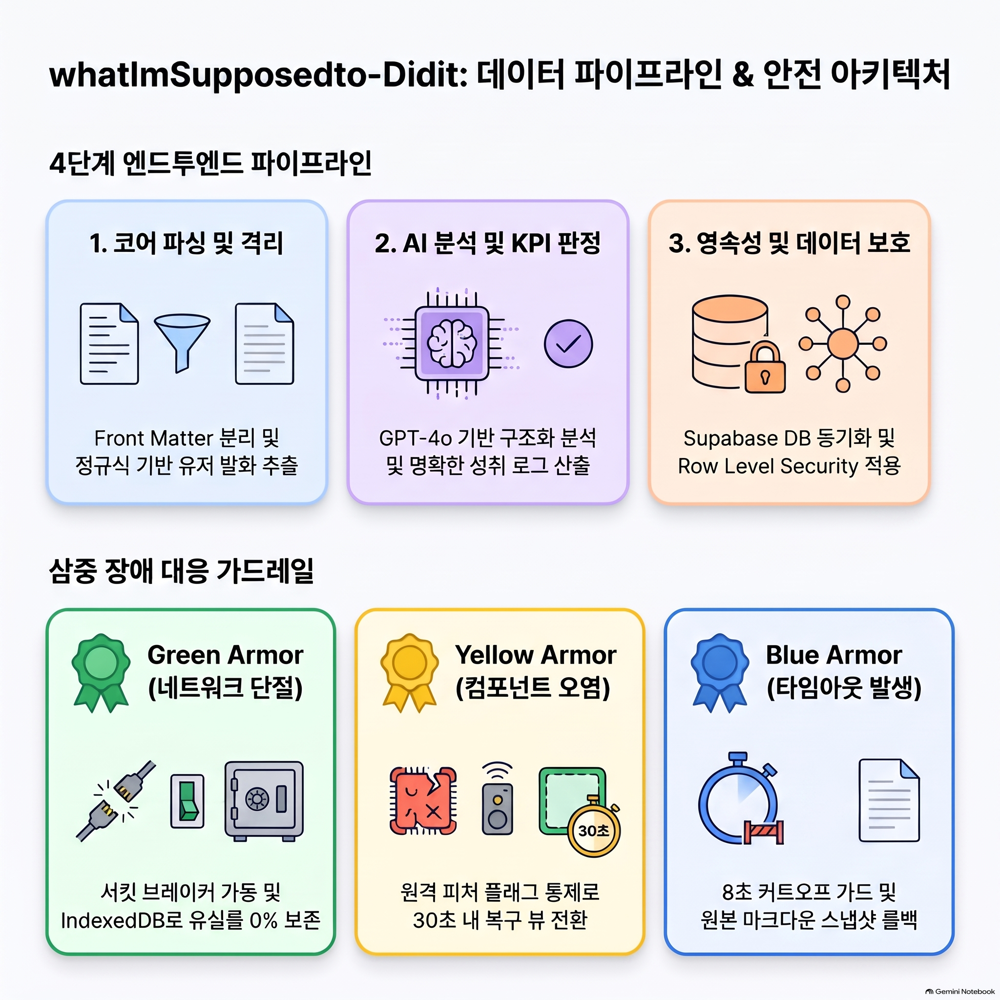
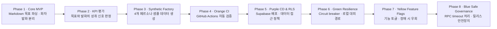

📂 What I'm Supposed to, Did It (왙엠아이서포스투딛잍)

MVP에서 출발하여 CI/CD 자동화, 서킷 브레이커 장애 격리, 피처 플래그 통제, 8초 트랜잭션 롤백까지 무중단 운영 가드레일을 장착한 마크다운 기반 KPI 인텔리전스 인프라입니다.
본 레포지토리는 사용자의 비정형 마크다운(.md) 목표와 실전 대화록 스트림을 대조 분석하여, 완벽주의 성향의 유저들에게 최적의 4단 처방전(원문-5세-치트키-소리)을 제공하고 성취도를 실시간으로 추적하는 엔터프라이즈급 프로덕션 시스템입니다.

## 데이터 파이프라인 및 안전 아키텍처



인포그래픽은 프로젝트의 전체 아키텍처 개요입니다. 현재 MVP의 실제 데이터 흐름은 아래 Mermaid 다이어그램을 기준으로 확인하세요. 게스트 분석은 브라우저에서 규칙 기반으로 실행되며, 입력 텍스트를 서버나 AI API로 전송하거나 DB에 저장하지 않습니다. 로그인·테스트 구독 데이터만 별도의 인증된 서버 경로에서 처리합니다.

```mermaid
flowchart TD
    subgraph guest["게스트 분석 — 브라우저 내 처리"]
        input["목표 Markdown · 대화록 · 대상 닉네임"]
        ui["Next.js 데모 화면"]
        parse["Markdown 파싱"]
        split["대상 화자 발화 분리"]
        evaluate["규칙 기반 KPI 평가"]
        prescribe["템플릿 기반 4단 데모 처방"]
        result["분석 결과 렌더링"]

        input --> ui --> parse --> split --> evaluate --> prescribe --> result
        result -. "React 화면 상태만 사용 · 영속 저장 없음" .-> ui
    end

    subgraph account["선택적 계정·테스트 구독 경로"]
        google["Google 로그인"]
        auth["Supabase Auth"]
        client["브라우저 Supabase 세션"]
        api["Next.js 테스트 계정 API"]
        verify["인증 토큰 · 인증된 Google 이메일 · 서버 허용목록 검증"]
        rpc["service-role 전용 RPC"]
        db[("Supabase 테스트 멤버십·모의 결제 이벤트")]
        deleteData["테스트 사용자 데이터 삭제 RPC"]
        deleteAuth["Supabase Auth 계정 삭제"]

        google --> auth --> client --> api --> verify --> rpc --> db
        verify --> deleteData --> db
        deleteData --> deleteAuth
    end
```



## ✅ 현재 상태
- 핵심 파서 및 KPI 엔진 검증 완료
- 자동 테스트: 7개 테스트 suite, 22개 테스트 통과 (파서, 발화 분리, KPI, 게스트 분석, 데모 프로필/테스트 계정, RPC timeout 회귀)
- 로그인 없이 체험하는 데모 UI: 목표·행동 기록 분석, 4단 규칙 기반 데모 처방
- 허용된 Google 테스트 계정에 가입 후 3일 이용권 자동 지급, 결제 없는 구독 시작·취소 모의, 로그아웃·계정 탈퇴 시험
- 별도 배포: [서비스 시연 소개](https://what-im-supposed-to-did-it-presenta.vercel.app/) · [MVP 직접 체험](https://what-im-supposed-to-did-it.vercel.app/)
- Supabase 원격 DB 점검 및 `ai_prescriptions` 권한 보완 완료
- GitHub webhook 서명 검증 및 비공개 전달 메타데이터 저장 구현
- 문서 체계 정리 완료: 아키텍처, 파서, AI 처방, KPI, 운영 가드레일 및 DB 상태 문서 포함
- GitHub 공개 저장소 반영 완료

## 📚 문서 인덱스
- [docs/01_ARCHITECTURE_OVERVIEW.md](docs/01_ARCHITECTURE_OVERVIEW.md): 전체 시스템 구조와 8단계 진화 모델
- [docs/02_CORE_PARSER_SPECIFICATION.md](docs/02_CORE_PARSER_SPECIFICATION.md): 마크다운 파서와 대화 스크립트 분리 명세
- [docs/03_AI_PRESCRIPTION_SCHEMA.md](docs/03_AI_PRESCRIPTION_SCHEMA.md): AI 처방 스키마 및 4단 처방 전략
- [docs/04_PERSONA_METADATA_REGISTRY.md](docs/04_PERSONA_METADATA_REGISTRY.md): 페르소나 메타데이터 레지스트리
- [docs/05_PURPLE_KPI_VALUATION_ENGINE.md](docs/05_PURPLE_KPI_VALUATION_ENGINE.md): 성취 판정 로직과 KPI 설계
- [docs/06_SYNTHETIC_DATA_FACTORY_GUIDE.md](docs/06_SYNTHETIC_DATA_FACTORY_GUIDE.md): 합성 데이터 생성 가이드
- [docs/07_ORANGE_CI_INTEGRATION_TEST.md](docs/07_ORANGE_CI_INTEGRATION_TEST.md): CI 자동화 및 품질 검증
- [docs/08_PURPLE_CD_SUPABASE_DEPLOYMENT.md](docs/08_PURPLE_CD_SUPABASE_DEPLOYMENT.md): 배포 및 운영 풀 설계
- [docs/09_DATABASE_MIGRATION_AND_RLS.md](docs/09_DATABASE_MIGRATION_AND_RLS.md): DB 스키마와 RLS 정책
- [docs/10_GREEN_CIRCUIT_BREAKER_SHELTER.md](docs/10_GREEN_CIRCUIT_BREAKER_SHELTER.md): 회로 차단기 설계
- [docs/11_YELLOW_FEATURE_FLAG_HOTFIX.md](docs/11_YELLOW_FEATURE_FLAG_HOTFIX.md): 피처 플래그 운영 기준
- [docs/12_BLUE_TRANSACTION_ROLLBACK_GATE.md](docs/12_BLUE_TRANSACTION_ROLLBACK_GATE.md): 롤백/거버넌스 안전장치
- [docs/13_GOOGLE_OAUTH_SIGNIN.md](docs/13_GOOGLE_OAUTH_SIGNIN.md): Google OAuth 로그인 설정
- [docs/14_SUPABASE_PROJECT_STATUS.md](docs/14_SUPABASE_PROJECT_STATUS.md): 원격 Supabase 스키마, 권한, 마이그레이션 점검 결과
- [docs/15_WEBHOOK_AND_RPC_SAFETY.md](docs/15_WEBHOOK_AND_RPC_SAFETY.md): GitHub webhook 서명·중복 전달·오류 처리 및 RPC timeout 한계
- [docs/16_DEMO_WEB_UI.md](docs/16_DEMO_WEB_UI.md): 데모 웹 UI 사용 방법, 로컬 분석 및 개인정보 처리 방식
- [presentation/](presentation/): MVP와 분리된 발표용 소개 페이지 (별도 Vercel 프로젝트)
- [docs/17_MVP_IMPLEMENTATION_SPEC.md](docs/17_MVP_IMPLEMENTATION_SPEC.md): MVP 사용자 흐름, 코드/데이터 계약, 작업 분해 및 완료 기준
- [docs/18_DEMO_TEST_ACCOUNT_RESET.md](docs/18_DEMO_TEST_ACCOUNT_RESET.md): 고정 Google 테스트 계정의 시연 데이터 초기화 및 권한 범위
- [docs/mvp_refs.md](docs/mvp_refs.md): 장기 제품 비전과 과거 요구사항 원문 (구현 상태의 근거가 아닌 참고 자료)

🏗️ 1. 프로젝트 폴더 구조 (Project Architecture)

```mermaid
flowchart TD
    repo["whatImSupposedto-Didit/"]

    repo --> github[".github/"]
    github --> workflows["workflows/"]
    workflows --> ci["04_orange_ci_automation.yml"]
    workflows --> cd["05_purple_cd_deployment.yml"]
    github --> agents["agents/"]

    repo --> assets["assets/"]
    assets --> samples["stage_02_samples/"]
    assets --> architecture["data-pipeline-security-architecture.png"]

    repo --> database["database/migrations/"]
    database --> dbmigrations["Schema · RLS · webhook · demo-account SQL"]

    repo --> docs["docs/"]
    docs --> designDocs["01–06 · 아키텍처 · 파서 · 처방 · 페르소나 · KPI · 데이터"]
    docs --> opsDocs["07–12 · CI/CD · DB/RLS · circuit breaker · feature flag · rollback"]
    docs --> productDocs["13–18 · OAuth · Supabase · webhook · demo UI · MVP · test account"]
    docs --> references["mvp_refs.md · 과거 요구사항 참고"]

    repo --> presentation["presentation/ · 별도 소개 사이트"]
    repo --> source["src/"]
    source --> app["app/ · Next.js UI 및 API routes"]
    source --> automation["automation/ · 페르소나 및 데이터 생성"]
    source --> core["core/ · parser · splitter · AI engine"]
    source --> demo["demo/ · 분석 및 로컬 테스트 프로필"]
    source --> lib["lib/ · Supabase 및 서버 인증"]
    source --> metrics["metrics/ · KPI 판정"]
    source --> operation["operation/ · 장애·기능 플래그·복구"]

    repo --> supabase["supabase/"]
    supabase --> functions["functions/repo-webhook-receiver/"]
    supabase --> migrations["migrations/"]
    repo --> tests["tests/ · Jest 단위·통합 테스트"]
    repo --> package["package.json · package-lock.json"]
    repo --> readme["README.md"]
```



🔄 2. 8단계 제품 진화 아키텍처 (The 8-Phase Evolution Model)



📚 3. 엔지니어링 문서 명세 (Documentation Hub)

상세 문서와 과거 요구사항 참고 자료는 [`docs/`](docs/)에서 확인할 수 있습니다.

```mermaid
flowchart TD
    hub["Engineering Documentation · docs/"]

    hub --> architecture["아키텍처 및 코어 설계"]
    architecture --> d01["01 · 시스템 아키텍처"]
    architecture --> d02["02 · Markdown parser / splitter"]
    architecture --> d03["03 · AI 처방 스키마"]

    hub --> product["지표 및 데이터 자산"]
    product --> d04["04 · 페르소나 레지스트리"]
    product --> d05["05 · Purple KPI"]
    product --> d06["06 · 합성 데이터 팩토리"]

    hub --> delivery["인프라 및 배포 자동화"]
    delivery --> d07["07 · Orange CI"]
    delivery --> d08["08 · Purple CD / Supabase"]
    delivery --> d09["09 · DB migration / RLS"]

    hub --> resilience["운영 안전장치"]
    resilience --> d10["10 · Green circuit breaker"]
    resilience --> d11["11 · Yellow feature flags"]
    resilience --> d12["12 · Blue rollback"]
    resilience --> d15["15 · Webhook / RPC 안전성"]

    hub --> account["인증 및 MVP 운영"]
    account --> d13["13 · Google OAuth"]
    account --> d14["14 · Supabase 상태 점검"]
    account --> d16["16 · 데모 웹 UI"]
    account --> d17["17 · MVP 구현 명세"]
    account --> d18["18 · 테스트 계정 초기화"]

    hub --> reference["mvp_refs.md · 과거 요구사항 참고"]
```



## 변경사항 전달 규칙

코드, 데이터베이스, 배포 또는 설정을 실질적으로 변경할 때는 관련 운영·설계 내용을 `docs/`에 자산화하고, README의 상태·문서 인덱스·설정 안내도 함께 최신화합니다. 검증 후 해당 작업에 속한 파일만 커밋하고 현재 브랜치에 푸시합니다. 생성 산출물, 환경 파일, 자격 증명 및 작업과 무관한 변경은 커밋에 포함하지 않습니다.

🚀 4. 빠른 시작 및 실행 프로토콜 (Quick Start)


환경 세팅 (Prerequisites)

데모 웹 UI는 외부 API 키나 로그인을 요구하지 않습니다. 로컬에서 바로 실행하려면:

```bash
npm ci
npm run dev
```

별도로 Supabase 연동 기능을 개발할 때만 프로젝트 루트에 `.env`를 만들고 필요한 환경변수를 설정합니다:
bash
cp .env.template .env
# 생성된 .env 파일 내부의 API_KEY 및 URL 변수값에 실전 인프라 토큰을 입력하세요.
Use code with caution.

테스트 계정 기능을 사용하려면 Supabase 마이그레이션을 적용하고 Vercel에 `DEMO_TEST_ACCOUNT_EMAIL` (Google 테스트 계정 이메일), `SUPABASE_SERVICE_ROLE_KEY` (서버 전용), `SUPABASE_URL`, `NEXT_PUBLIC_SITE_URL`을 설정합니다. `SUPABASE_SERVICE_ROLE_KEY`는 Secret으로 보관합니다. 구독 화면은 지금은 모의 동작이며 실제 결제나 청구가 없습니다. Toss 연동은 보류 중입니다. 이메일과 서비스 키를 채팅이나 클라이언트 코드에 넣지 마세요.

1단계: 의존성 설치 및 무결성 빌드

bash
npm ci
npm run build
Use code with caution.

2단계: 테스트 자산 대량 양산 (Phase 3 시뮬레이션)

bash
npm run automation:generate
Use code with caution.

3단계: 가드레일 통합 테스트 및 스트레스 전수 검사 (Phase 2 & 4 시뮬레이션)

bash
npm run test
Use code with caution.

🚨 5. 라이브 서비스 비상 진화 운용 프로토콜 (Runbook)


시나리오 A: OpenAI API 장애 및 네트워크 병목 발생 시

• 시스템 자동 대응 (Phase 6): ApiCircuitBreaker.ts가 타임아웃(5000ms)을 감지하고 회로를 차단합니다.
• 데이터 보호: 사용자의 데이터 스트림은 즉시 프론트엔드 src/operation/localEmergencyStorage.ts로 우회 라우팅되어 브라우저 로컬 IndexedDB에 안전하게 대피 보존됩니다.

시나리오 B: 특정 페르소나 파서 렌더링에 깨짐 리스크 리포트 시

• 무다운타임 진화 조치 (Phase 7): 서버 재배포 없이 Supabase system_feature_flags 테이블의 설정을 변경합니다.
sql
UPDATE public.system_feature_flags 
SET is_enabled = false 
WHERE key = 'enable-phonics-hyphen-component';
Use code with caution.
• 결과: 캐시 TTL(30초) 경과 후 ToggleGateway.ts가 작동하여 하이픈 컴포넌트를 차단하고 안전한 일반 플레인 텍스트 모드로 실시간 우회 렌더링을 시작합니다.

시나리오 C: 파싱 트랜잭션 데드락 및 데이터 오염 발생 시

• 원자성 강제 수호 (Phase 8): RollbackHandler.ts가 가동하는 8초 데드라인 타이머가 작동합니다.
• 결과: 8초 이내에 처리가 완료되지 않을 경우 데이터베이스 저장 프로시저(execute_safe_prescription_transaction)가 동작을 완전 무효화(Abort)하여 오염 전 상태의 안전한 마크다운 백업 데이터셋 스냅샷을 완벽하게 보존합니다.